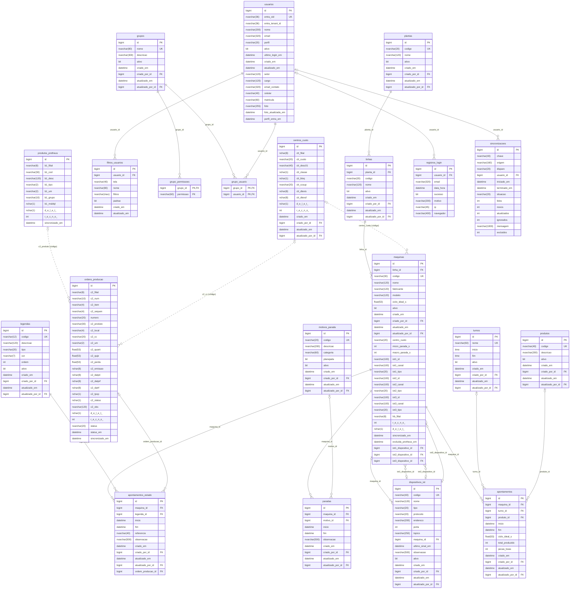

# Banco de dados — OEE Alumbra

> Gerado por `php artisan banco:documentar` a partir das migrações (tipos do **SQL Server**). Não edite as
> seções geradas: mude a migração e gere de novo. O trecho "Decisões e sugestões de modelagem" é mantido.

- **21** tabelas do sistema e **6** de infraestrutura do Laravel.
- Origem: **Sistema OEE** (criada e mantida pelo portal), **Protheus** (copiada pela sincronização, só leitura no Protheus) ou
  **Mista** (parte dos campos vem do Protheus na primeira sincronização e o resto é do portal).
- Todas as datas são gravadas em UTC. Cadastros têm auditoria (`criado_em`, `criado_por_id`, `atualizado_em`, `atualizado_por_id` → `usuarios`).

## Diagrama

Tabelas de infraestrutura e as ligações de auditoria (`criado_por_id`/`atualizado_por_id` → `usuarios`) ficam fora do
diagrama para ele ficar legível. Linha tracejada = ligação por código, sem chave estrangeira no banco.

## Decisões e sugestões de modelagem

<!-- manual:inicio -->
Mantido pelo agente `arquiteto-banco-dados`. Cada item diz se já foi aplicado ou se é só sugestão.

**Convenções em uso**

- Chave primária: `id` `bigint identity` em toda tabela; tabelas de ligação (`grupo_usuario`, `grupo_permissoes`) usam
  chave composta pelas duas colunas.
- Chave estrangeira: `<tabela_no_singular>_id` → `<tabela>.id`, sem exclusão em cascata (cadastros são desativados).
- Índices: toda FK usada em filtro tem índice; dados de produção (`apontamentos`, `apontamentos_estado`, `paradas`) têm
  índice composto `(maquina_id, inicio)`, que é o filtro de todas as telas de produção.
- Tabelas do Protheus (`centros_custo`) mantêm os nomes e tipos da origem (`ctt_*`, `d_e_l_e_t_`, `r_e_c_n_o_`) e a
  chave natural do Protheus como índice único (`ctt_filial`, `ctt_custo`).
- **Decisão (aplicada): `maquinas` é tabela mista com `Compras.SHB`.** Código (`HB_COD`), nome (`HB_NOME`) e centro de
  custo (`HB_CC`) vêm do Protheus só na primeira sincronização; a máquina chega inativa e sem linha (`linha_id` passou a
  aceitar vazio). Guarda `hb_filial`, `r_e_c_n_o_` e `d_e_l_e_t_` de origem (`r_e_c_n_o_` preenchido = veio do
  Protheus). Depois só a exclusão no Protheus altera a máquina (marca `d_e_l_e_t_ = '*'` e desativa). Regras no SQL
  Server: máquina ativa precisa de linha (`ck_maquinas_ativa_com_linha`) e máquina excluída no Protheus não fica ativa
  (`ck_maquinas_ativa_nao_excluida`).

**Sugestões (ainda não aplicadas)**

1. `maquinas.centro_custo` guarda só o código (sem filial e sem FK), como vem em `HB_CC` da SHB. Se a CTT tiver o
   mesmo código em filiais diferentes, a ligação fica ambígua. Sugestão: usar também `maquinas.hb_filial` para achar o
   centro de custo da mesma filial (ou o compartilhado), ou trocar por `centro_custo_id` → `centros_custo.id`.
2. `maquinas.iot1_* .. iot3_*` repete o mesmo trio de colunas três vezes e não se liga a `dispositivos_iot`. Sugestão:
   tabela `maquina_canais_iot` (`maquina_id`, `posicao`, `dispositivo_iot_id`, `canal`, `tipo`) com PK
   (`maquina_id`, `posicao`) — permite mais de 3 canais e FK para o dispositivo.
3. Há dois modelos de parada em paralelo: `paradas` + `motivos_parada` e `apontamentos_estado` + `legendas`. Vale
   decidir qual é o oficial para o cálculo de OEE e migrar o outro, para não haver duas fontes de verdade.
4. `apontamentos_estado` não tem `turno_id`; o turno é deduzido pelo horário. Se o turno puder mudar de horário com o
   tempo, gravar o `turno_id` no apontamento (como em `apontamentos`) preserva o histórico.
<!-- manual:fim -->

## Tabelas

| Tabela | Origem | Chave primária | Colunas | Ligações (FK) |
|---|---|---|---|---|
| [`apontamentos`](#apontamentos) | Sistema | `id` | 13 | 5 |
| [`apontamentos_estado`](#apontamentos_estado) | Sistema | `id` | 12 | 5 |
| [`cache`](#cache) | Infra | `key` | 3 | 0 |
| [`cache_locks`](#cache_locks) | Infra | `key` | 3 | 0 |
| [`centros_custo`](#centros_custo) | Protheus | `id` | 15 | 2 |
| [`dispositivos_iot`](#dispositivos_iot) | Sistema | `id` | 16 | 3 |
| [`failed_jobs`](#failed_jobs) | Infra | `id` | 7 | 0 |
| [`filtros_usuarios`](#filtros_usuarios) | Sistema | `id` | 8 | 1 |
| [`grupo_permissoes`](#grupo_permissoes) | Sistema | `grupo_id, permissao` | 2 | 1 |
| [`grupo_usuario`](#grupo_usuario) | Sistema | `grupo_id, usuario_id` | 2 | 2 |
| [`grupos`](#grupos) | Sistema | `id` | 8 | 2 |
| [`job_batches`](#job_batches) | Infra | `id` | 10 | 0 |
| [`jobs`](#jobs) | Infra | `id` | 7 | 0 |
| [`legendas`](#legendas) | Sistema | `id` | 11 | 2 |
| [`linhas`](#linhas) | Sistema | `id` | 9 | 3 |
| [`maquinas`](#maquinas) | Mista | `id` | 32 | 6 |
| [`motivos_parada`](#motivos_parada) | Sistema | `id` | 10 | 2 |
| [`ordens_producao`](#ordens_producao) | Protheus | `id` | 25 | 0 |
| [`paradas`](#paradas) | Sistema | `id` | 10 | 4 |
| [`plantas`](#plantas) | Sistema | `id` | 8 | 2 |
| [`produtos`](#produtos) | Sistema | `id` | 8 | 2 |
| [`produtos_protheus`](#produtos_protheus) | Protheus | `id` | 11 | 0 |
| [`registros_login`](#registros_login) | Sistema | `id` | 8 | 1 |
| [`sessions`](#sessions) | Infra | `id` | 6 | 0 |
| [`sincronizacoes`](#sincronizacoes) | Sistema | `id` | 14 | 1 |
| [`turnos`](#turnos) | Sistema | `id` | 9 | 2 |
| [`usuarios`](#usuarios) | Sistema | `id` | 18 | 0 |

### apontamentos

**Origem:** Sistema OEE · **Chave primária:** `id`

| Coluna | Tipo (SQL Server) | Nulo | Padrão | Chave |
|---|---|---|---|---|
| `id` | `bigint` | não |  | PK (identity) |
| `maquina_id` | `bigint` | não |  | FK → `maquinas.id` |
| `turno_id` | `bigint` | sim |  | FK → `turnos.id` |
| `produto_id` | `bigint` | sim |  | FK → `produtos.id` |
| `inicio` | `datetime` | não |  |  |
| `fim` | `datetime` | não |  |  |
| `ciclo_ideal_s` | `float(53)` | não |  |  |
| `total_produzido` | `int` | não |  |  |
| `pecas_boas` | `int` | não |  |  |
| `criado_em` | `datetime` | sim |  |  |
| `criado_por_id` | `bigint` | sim |  | FK → `usuarios.id` |
| `atualizado_em` | `datetime` | sim |  |  |
| `atualizado_por_id` | `bigint` | sim |  | FK → `usuarios.id` |

**Índices:** `apontamentos_maquina_id_inicio_index` (maquina_id, inicio)

**Regras (CHECK, só no SQL Server):** `ck_apontamentos_periodo`: `fim > inicio` · `ck_apontamentos_pecas`: `pecas_boas >= 0 AND pecas_boas <= total_produzido`

### apontamentos_estado

**Origem:** Sistema OEE · **Chave primária:** `id`

| Coluna | Tipo (SQL Server) | Nulo | Padrão | Chave |
|---|---|---|---|---|
| `id` | `bigint` | não |  | PK (identity) |
| `maquina_id` | `bigint` | não |  | FK → `maquinas.id` |
| `legenda_id` | `bigint` | não |  | FK → `legendas.id` |
| `inicio` | `datetime` | não |  |  |
| `fim` | `datetime` | sim |  |  |
| `referencia` | `nvarchar(40)` | sim |  |  |
| `observacao` | `nvarchar(500)` | sim |  |  |
| `criado_em` | `datetime` | sim |  |  |
| `criado_por_id` | `bigint` | sim |  | FK → `usuarios.id` |
| `atualizado_em` | `datetime` | sim |  |  |
| `atualizado_por_id` | `bigint` | sim |  | FK → `usuarios.id` |
| `ordem_producao_id` | `bigint` | sim |  | FK → `ordens_producao.id` |

**Índices:** `apontamentos_estado_maquina_id_inicio_index` (maquina_id, inicio) · `apontamentos_estado_ordem_producao_id_index` (ordem_producao_id)

**Regras (CHECK, só no SQL Server):** `ck_apontamentos_estado_periodo`: `fim IS NULL OR fim > inicio`

### cache

**Origem:** Infraestrutura do Laravel · **Chave primária:** `key`

| Coluna | Tipo (SQL Server) | Nulo | Padrão | Chave |
|---|---|---|---|---|
| `key` | `nvarchar(255)` | não |  | PK |
| `value` | `nvarchar(max)` | não |  |  |
| `expiration` | `bigint` | não |  |  |

**Índices:** `cache_expiration_index` (expiration)

### cache_locks

**Origem:** Infraestrutura do Laravel · **Chave primária:** `key`

| Coluna | Tipo (SQL Server) | Nulo | Padrão | Chave |
|---|---|---|---|---|
| `key` | `nvarchar(255)` | não |  | PK |
| `owner` | `nvarchar(255)` | não |  |  |
| `expiration` | `bigint` | não |  |  |

**Índices:** `cache_locks_expiration_index` (expiration)

### centros_custo

**Origem:** Protheus — sincronizada de `Compras.CTT` · **Chave primária:** `id`

| Coluna | Tipo (SQL Server) | Nulo | Padrão | Chave |
|---|---|---|---|---|
| `id` | `bigint` | não |  | PK (identity) |
| `ctt_filial` | `nchar(8)` | não | `''` |  |
| `ctt_custo` | `nvarchar(20)` | não |  |  |
| `ctt_desc01` | `nvarchar(40)` | não |  |  |
| `ctt_classe` | `nchar(1)` | não | `'2'` |  |
| `ctt_bloq` | `nchar(1)` | não | `'2'` |  |
| `ctt_ccsup` | `nvarchar(20)` | não | `''` |  |
| `ctt_dtexis` | `nchar(8)` | não | `''` |  |
| `ctt_dtexsf` | `nchar(8)` | não | `''` |  |
| `d_e_l_e_t_` | `nchar(1)` | não | `' '` |  |
| `r_e_c_n_o_` | `int` | sim |  |  |
| `criado_em` | `datetime` | sim |  |  |
| `criado_por_id` | `bigint` | sim |  | FK → `usuarios.id` |
| `atualizado_em` | `datetime` | sim |  |  |
| `atualizado_por_id` | `bigint` | sim |  | FK → `usuarios.id` |

**Índices:** `centros_custo_ctt_filial_ctt_custo_unique` único (ctt_filial, ctt_custo) · `centros_custo_ctt_custo_index` (ctt_custo)

**Regras (CHECK, só no SQL Server):** `ck_centros_custo_classe`: `ctt_classe IN ('1', '2')` · `ck_centros_custo_bloq`: `ctt_bloq IN ('1', '2')`

### dispositivos_iot

**Origem:** Sistema OEE · **Chave primária:** `id`

| Coluna | Tipo (SQL Server) | Nulo | Padrão | Chave |
|---|---|---|---|---|
| `id` | `bigint` | não |  | PK (identity) |
| `codigo` | `nvarchar(40)` | não |  |  |
| `nome` | `nvarchar(120)` | não |  |  |
| `tipo` | `nvarchar(20)` | não |  |  |
| `protocolo` | `nvarchar(20)` | não |  |  |
| `endereco` | `nvarchar(200)` | sim |  |  |
| `porta` | `int` | sim |  |  |
| `topico` | `nvarchar(250)` | sim |  |  |
| `maquina_id` | `bigint` | sim |  | FK → `maquinas.id` |
| `ultimo_sinal_em` | `datetime` | sim |  |  |
| `observacao` | `nvarchar(500)` | sim |  |  |
| `ativo` | `bit` | não | `'1'` |  |
| `criado_em` | `datetime` | sim |  |  |
| `criado_por_id` | `bigint` | sim |  | FK → `usuarios.id` |
| `atualizado_em` | `datetime` | sim |  |  |
| `atualizado_por_id` | `bigint` | sim |  | FK → `usuarios.id` |

**Índices:** `dispositivos_iot_codigo_unique` único (codigo) · `dispositivos_iot_maquina_id_index` (maquina_id)

### failed_jobs

**Origem:** Infraestrutura do Laravel · **Chave primária:** `id`

| Coluna | Tipo (SQL Server) | Nulo | Padrão | Chave |
|---|---|---|---|---|
| `id` | `bigint` | não |  | PK (identity) |
| `uuid` | `nvarchar(255)` | não |  |  |
| `connection` | `nvarchar(255)` | não |  |  |
| `queue` | `nvarchar(255)` | não |  |  |
| `payload` | `nvarchar(max)` | não |  |  |
| `exception` | `nvarchar(max)` | não |  |  |
| `failed_at` | `datetime` | não | `CURRENT_TIMESTAMP` |  |

**Índices:** `failed_jobs_uuid_unique` único (uuid) · `failed_jobs_connection_queue_failed_at_index` (connection, queue, failed_at)

### filtros_usuarios

**Origem:** Sistema OEE · **Chave primária:** `id`

| Coluna | Tipo (SQL Server) | Nulo | Padrão | Chave |
|---|---|---|---|---|
| `id` | `bigint` | não |  | PK (identity) |
| `usuario_id` | `bigint` | não |  | FK → `usuarios.id` |
| `tela` | `nvarchar(40)` | não |  |  |
| `nome` | `nvarchar(80)` | não |  |  |
| `filtros` | `nvarchar(max)` | não |  |  |
| `padrao` | `bit` | não | `'0'` |  |
| `criado_em` | `datetime` | sim |  |  |
| `atualizado_em` | `datetime` | sim |  |  |

**Índices:** `filtros_usuarios_usuario_id_tela_nome_unique` único (usuario_id, tela, nome)

### grupo_permissoes

**Origem:** Sistema OEE · **Chave primária:** `grupo_id, permissao`

| Coluna | Tipo (SQL Server) | Nulo | Padrão | Chave |
|---|---|---|---|---|
| `grupo_id` | `bigint` | não |  | PK; FK → `grupos.id` |
| `permissao` | `nvarchar(60)` | não |  | PK |

### grupo_usuario

**Origem:** Sistema OEE · **Chave primária:** `grupo_id, usuario_id`

| Coluna | Tipo (SQL Server) | Nulo | Padrão | Chave |
|---|---|---|---|---|
| `grupo_id` | `bigint` | não |  | PK; FK → `grupos.id` |
| `usuario_id` | `bigint` | não |  | PK; FK → `usuarios.id` |

### grupos

**Origem:** Sistema OEE · **Chave primária:** `id`

| Coluna | Tipo (SQL Server) | Nulo | Padrão | Chave |
|---|---|---|---|---|
| `id` | `bigint` | não |  | PK (identity) |
| `nome` | `nvarchar(80)` | não |  |  |
| `descricao` | `nvarchar(300)` | sim |  |  |
| `ativo` | `bit` | não | `'1'` |  |
| `criado_em` | `datetime` | sim |  |  |
| `criado_por_id` | `bigint` | sim |  | FK → `usuarios.id` |
| `atualizado_em` | `datetime` | sim |  |  |
| `atualizado_por_id` | `bigint` | sim |  | FK → `usuarios.id` |

**Índices:** `grupos_nome_unique` único (nome)

### job_batches

**Origem:** Infraestrutura do Laravel · **Chave primária:** `id`

| Coluna | Tipo (SQL Server) | Nulo | Padrão | Chave |
|---|---|---|---|---|
| `id` | `nvarchar(255)` | não |  | PK |
| `name` | `nvarchar(255)` | não |  |  |
| `total_jobs` | `int` | não |  |  |
| `pending_jobs` | `int` | não |  |  |
| `failed_jobs` | `int` | não |  |  |
| `failed_job_ids` | `nvarchar(max)` | não |  |  |
| `options` | `nvarchar(max)` | sim |  |  |
| `cancelled_at` | `int` | sim |  |  |
| `created_at` | `int` | não |  |  |
| `finished_at` | `int` | sim |  |  |

### jobs

**Origem:** Infraestrutura do Laravel · **Chave primária:** `id`

| Coluna | Tipo (SQL Server) | Nulo | Padrão | Chave |
|---|---|---|---|---|
| `id` | `bigint` | não |  | PK (identity) |
| `queue` | `nvarchar(255)` | não |  |  |
| `payload` | `nvarchar(max)` | não |  |  |
| `attempts` | `smallint` | não |  |  |
| `reserved_at` | `int` | sim |  |  |
| `available_at` | `int` | não |  |  |
| `created_at` | `int` | não |  |  |

**Índices:** `jobs_queue_index` (queue)

### legendas

**Origem:** Sistema OEE · **Chave primária:** `id`

| Coluna | Tipo (SQL Server) | Nulo | Padrão | Chave |
|---|---|---|---|---|
| `id` | `bigint` | não |  | PK (identity) |
| `codigo` | `nvarchar(12)` | não |  |  |
| `descricao` | `nvarchar(120)` | não |  |  |
| `tipo` | `nvarchar(20)` | não |  |  |
| `cor` | `nvarchar(7)` | não |  |  |
| `ordem` | `int` | não | `'0'` |  |
| `ativo` | `bit` | não | `'1'` |  |
| `criado_em` | `datetime` | sim |  |  |
| `criado_por_id` | `bigint` | sim |  | FK → `usuarios.id` |
| `atualizado_em` | `datetime` | sim |  |  |
| `atualizado_por_id` | `bigint` | sim |  | FK → `usuarios.id` |

**Índices:** `legendas_codigo_unique` único (codigo)

**Regras (CHECK, só no SQL Server):** `ck_legendas_tipo`: `tipo IN ('produzindo', 'parada', 'planejada', 'desligada')`

### linhas

**Origem:** Sistema OEE · **Chave primária:** `id`

| Coluna | Tipo (SQL Server) | Nulo | Padrão | Chave |
|---|---|---|---|---|
| `id` | `bigint` | não |  | PK (identity) |
| `planta_id` | `bigint` | não |  | FK → `plantas.id` |
| `codigo` | `nvarchar(20)` | não |  |  |
| `nome` | `nvarchar(120)` | não |  |  |
| `ativo` | `bit` | não | `'1'` |  |
| `criado_em` | `datetime` | sim |  |  |
| `criado_por_id` | `bigint` | sim |  | FK → `usuarios.id` |
| `atualizado_em` | `datetime` | sim |  |  |
| `atualizado_por_id` | `bigint` | sim |  | FK → `usuarios.id` |

**Índices:** `linhas_planta_id_codigo_unique` único (planta_id, codigo)

### maquinas

**Origem:** Mista — parte dos campos vem de `Compras.SHB` (Protheus), o resto é do Sistema OEE · **Chave primária:** `id`

| Coluna | Tipo (SQL Server) | Nulo | Padrão | Chave |
|---|---|---|---|---|
| `id` | `bigint` | não |  | PK (identity) |
| `linha_id` | `bigint` | não |  | FK → `linhas.id` |
| `codigo` | `nvarchar(30)` | não |  |  |
| `nome` | `nvarchar(120)` | não |  |  |
| `fabricante` | `nvarchar(120)` | sim |  |  |
| `modelo` | `nvarchar(120)` | sim |  |  |
| `ciclo_ideal_s` | `float(53)` | sim |  |  |
| `ativo` | `bit` | não | `'1'` |  |
| `criado_em` | `datetime` | sim |  |  |
| `criado_por_id` | `bigint` | sim |  | FK → `usuarios.id` |
| `atualizado_em` | `datetime` | sim |  |  |
| `atualizado_por_id` | `bigint` | sim |  | FK → `usuarios.id` |
| `centro_custo` | `nvarchar(20)` | sim |  | código → `centros_custo.ctt_custo` (sem FK) |
| `micro_parada_s` | `int` | sim |  |  |
| `macro_parada_s` | `int` | sim |  |  |
| `iot1_id` | `nvarchar(100)` | sim |  |  |
| `iot1_canal` | `nvarchar(100)` | sim |  |  |
| `iot1_tipo` | `nvarchar(20)` | sim |  |  |
| `iot2_id` | `nvarchar(100)` | sim |  |  |
| `iot2_canal` | `nvarchar(100)` | sim |  |  |
| `iot2_tipo` | `nvarchar(20)` | sim |  |  |
| `iot3_id` | `nvarchar(100)` | sim |  |  |
| `iot3_canal` | `nvarchar(100)` | sim |  |  |
| `iot3_tipo` | `nvarchar(20)` | sim |  |  |
| `hb_filial` | `nvarchar(8)` | sim |  |  |
| `r_e_c_n_o_` | `int` | sim |  |  |
| `d_e_l_e_t_` | `nchar(1)` | não | `' '` |  |
| `sincronizado_em` | `datetime` | sim |  |  |
| `excluida_protheus_em` | `datetime` | sim |  |  |
| `iot1_dispositivo_id` | `bigint` | sim |  | FK → `dispositivos_iot.id` |
| `iot2_dispositivo_id` | `bigint` | sim |  | FK → `dispositivos_iot.id` |
| `iot3_dispositivo_id` | `bigint` | sim |  | FK → `dispositivos_iot.id` |

**Índices:** `maquinas_codigo_unique` único (codigo) · `maquinas_centro_custo_index` (centro_custo) · `maquinas_hb_filial_r_e_c_n_o__index` (hb_filial, r_e_c_n_o_)

**Regras (CHECK, só no SQL Server):** `ck_maquinas_paradas`: `micro_parada_s IS NULL OR macro_parada_s IS NULL OR macro_parada_s > micro_parada_s` · `ck_maquinas_iot1_tipo`: `iot1_tipo IS NULL OR iot1_tipo IN ('producao', 'refugo')` · `ck_maquinas_iot2_tipo`: `iot2_tipo IS NULL OR iot2_tipo IN ('producao', 'refugo')` · `ck_maquinas_iot3_tipo`: `iot3_tipo IS NULL OR iot3_tipo IN ('producao', 'refugo')` · `ck_maquinas_d_e_l_e_t_`: `d_e_l_e_t_ IN (' ', '*')` · `ck_maquinas_ativa_com_linha`: `ativo = 0 OR linha_id IS NOT NULL` · `ck_maquinas_ativa_nao_excluida`: `ativo = 0 OR d_e_l_e_t_ <> '*'`

### motivos_parada

**Origem:** Sistema OEE · **Chave primária:** `id`

| Coluna | Tipo (SQL Server) | Nulo | Padrão | Chave |
|---|---|---|---|---|
| `id` | `bigint` | não |  | PK (identity) |
| `codigo` | `nvarchar(20)` | não |  |  |
| `descricao` | `nvarchar(200)` | não |  |  |
| `categoria` | `nvarchar(60)` | sim |  |  |
| `planejada` | `bit` | não | `'0'` |  |
| `ativo` | `bit` | não | `'1'` |  |
| `criado_em` | `datetime` | sim |  |  |
| `criado_por_id` | `bigint` | sim |  | FK → `usuarios.id` |
| `atualizado_em` | `datetime` | sim |  |  |
| `atualizado_por_id` | `bigint` | sim |  | FK → `usuarios.id` |

**Índices:** `motivos_parada_codigo_unique` único (codigo)

### ordens_producao

**Origem:** Protheus — sincronizada de `Compras.SC2` · **Chave primária:** `id`

| Coluna | Tipo (SQL Server) | Nulo | Padrão | Chave |
|---|---|---|---|---|
| `id` | `bigint` | não |  | PK (identity) |
| `c2_filial` | `nvarchar(8)` | não | `''` |  |
| `c2_num` | `nvarchar(10)` | não |  |  |
| `c2_item` | `nvarchar(4)` | não | `''` |  |
| `c2_sequen` | `nvarchar(4)` | não | `''` |  |
| `numero` | `nvarchar(20)` | não |  |  |
| `c2_produto` | `nvarchar(30)` | não | `''` | código → `produtos_protheus.b1_cod` (sem FK) |
| `c2_local` | `nvarchar(4)` | não | `''` |  |
| `c2_cc` | `nvarchar(20)` | não | `''` | código → `centros_custo.ctt_custo` (sem FK) |
| `c2_um` | `nvarchar(2)` | não | `''` |  |
| `c2_quant` | `float(53)` | não | `'0'` |  |
| `c2_quje` | `float(53)` | não | `'0'` |  |
| `c2_perda` | `float(53)` | não | `'0'` |  |
| `c2_emissao` | `nchar(8)` | não | `''` |  |
| `c2_datpri` | `nchar(8)` | não | `''` |  |
| `c2_datprf` | `nchar(8)` | não | `''` |  |
| `c2_datrf` | `nchar(8)` | não | `''` |  |
| `c2_tpop` | `nchar(1)` | não | `''` |  |
| `c2_status` | `nchar(1)` | não | `''` |  |
| `c2_obs` | `nvarchar(120)` | não | `''` |  |
| `d_e_l_e_t_` | `nchar(1)` | não | `' '` |  |
| `r_e_c_n_o_` | `int` | sim |  |  |
| `status` | `nvarchar(20)` | não | `'aberta'` |  |
| `status_em` | `datetime` | sim |  |  |
| `sincronizado_em` | `datetime` | sim |  |  |

**Índices:** `ordens_producao_c2_filial_c2_num_c2_item_c2_sequen_unique` único (c2_filial, c2_num, c2_item, c2_sequen) · `ordens_producao_numero_index` (numero) · `ordens_producao_status_c2_datprf_index` (status, c2_datprf) · `ordens_producao_c2_produto_index` (c2_produto)

**Regras (CHECK, só no SQL Server):** `ck_ordens_producao_status`: `status IN ('aberta', 'andamento', 'fechada', 'parada')`

### paradas

**Origem:** Sistema OEE · **Chave primária:** `id`

| Coluna | Tipo (SQL Server) | Nulo | Padrão | Chave |
|---|---|---|---|---|
| `id` | `bigint` | não |  | PK (identity) |
| `maquina_id` | `bigint` | não |  | FK → `maquinas.id` |
| `motivo_id` | `bigint` | sim |  | FK → `motivos_parada.id` |
| `inicio` | `datetime` | não |  |  |
| `fim` | `datetime` | sim |  |  |
| `observacao` | `nvarchar(500)` | sim |  |  |
| `criado_em` | `datetime` | sim |  |  |
| `criado_por_id` | `bigint` | sim |  | FK → `usuarios.id` |
| `atualizado_em` | `datetime` | sim |  |  |
| `atualizado_por_id` | `bigint` | sim |  | FK → `usuarios.id` |

**Índices:** `paradas_maquina_id_inicio_index` (maquina_id, inicio)

**Regras (CHECK, só no SQL Server):** `ck_paradas_periodo`: `fim IS NULL OR fim > inicio`

### plantas

**Origem:** Sistema OEE · **Chave primária:** `id`

| Coluna | Tipo (SQL Server) | Nulo | Padrão | Chave |
|---|---|---|---|---|
| `id` | `bigint` | não |  | PK (identity) |
| `codigo` | `nvarchar(20)` | não |  |  |
| `nome` | `nvarchar(120)` | não |  |  |
| `ativo` | `bit` | não | `'1'` |  |
| `criado_em` | `datetime` | sim |  |  |
| `criado_por_id` | `bigint` | sim |  | FK → `usuarios.id` |
| `atualizado_em` | `datetime` | sim |  |  |
| `atualizado_por_id` | `bigint` | sim |  | FK → `usuarios.id` |

**Índices:** `plantas_codigo_unique` único (codigo)

### produtos

**Origem:** Sistema OEE · **Chave primária:** `id`

| Coluna | Tipo (SQL Server) | Nulo | Padrão | Chave |
|---|---|---|---|---|
| `id` | `bigint` | não |  | PK (identity) |
| `codigo` | `nvarchar(40)` | não |  |  |
| `descricao` | `nvarchar(200)` | não |  |  |
| `ativo` | `bit` | não | `'1'` |  |
| `criado_em` | `datetime` | sim |  |  |
| `criado_por_id` | `bigint` | sim |  | FK → `usuarios.id` |
| `atualizado_em` | `datetime` | sim |  |  |
| `atualizado_por_id` | `bigint` | sim |  | FK → `usuarios.id` |

**Índices:** `produtos_codigo_unique` único (codigo)

### produtos_protheus

**Origem:** Protheus — sincronizada de `Compras.SB1` · **Chave primária:** `id`

| Coluna | Tipo (SQL Server) | Nulo | Padrão | Chave |
|---|---|---|---|---|
| `id` | `bigint` | não |  | PK (identity) |
| `b1_filial` | `nvarchar(8)` | não | `''` |  |
| `b1_cod` | `nvarchar(30)` | não |  |  |
| `b1_desc` | `nvarchar(120)` | não | `''` |  |
| `b1_tipo` | `nvarchar(2)` | não | `''` |  |
| `b1_um` | `nvarchar(2)` | não | `''` |  |
| `b1_grupo` | `nvarchar(10)` | não | `''` |  |
| `b1_msblql` | `nchar(1)` | não | `'2'` |  |
| `d_e_l_e_t_` | `nchar(1)` | não | `' '` |  |
| `r_e_c_n_o_` | `int` | sim |  |  |
| `sincronizado_em` | `datetime` | sim |  |  |

**Índices:** `produtos_protheus_b1_filial_b1_cod_unique` único (b1_filial, b1_cod) · `produtos_protheus_b1_cod_index` (b1_cod)

**Regras (CHECK, só no SQL Server):** `ck_produtos_protheus_msblql`: `b1_msblql IN ('1', '2')`

### registros_login

**Origem:** Sistema OEE · **Chave primária:** `id`

| Coluna | Tipo (SQL Server) | Nulo | Padrão | Chave |
|---|---|---|---|---|
| `id` | `bigint` | não |  | PK (identity) |
| `usuario_id` | `bigint` | sim |  | FK → `usuarios.id` |
| `email` | `nvarchar(320)` | sim |  |  |
| `data_hora` | `datetime` | não |  |  |
| `sucesso` | `bit` | não |  |  |
| `motivo` | `nvarchar(200)` | sim |  |  |
| `ip` | `nvarchar(45)` | sim |  |  |
| `navegador` | `nvarchar(400)` | sim |  |  |

**Índices:** `registros_login_data_hora_index` (data_hora)

### sessions

**Origem:** Infraestrutura do Laravel · **Chave primária:** `id`

| Coluna | Tipo (SQL Server) | Nulo | Padrão | Chave |
|---|---|---|---|---|
| `id` | `nvarchar(255)` | não |  | PK |
| `user_id` | `bigint` | sim |  |  |
| `ip_address` | `nvarchar(45)` | sim |  |  |
| `user_agent` | `nvarchar(max)` | sim |  |  |
| `payload` | `nvarchar(max)` | não |  |  |
| `last_activity` | `int` | não |  |  |

**Índices:** `sessions_user_id_index` (user_id) · `sessions_last_activity_index` (last_activity)

### sincronizacoes

**Origem:** Sistema OEE · **Chave primária:** `id`

| Coluna | Tipo (SQL Server) | Nulo | Padrão | Chave |
|---|---|---|---|---|
| `id` | `bigint` | não |  | PK (identity) |
| `chave` | `nvarchar(40)` | não |  |  |
| `origem` | `nvarchar(160)` | não |  |  |
| `disparo` | `nvarchar(20)` | não |  |  |
| `usuario_id` | `bigint` | sim |  | FK → `usuarios.id` |
| `iniciado_em` | `datetime` | não |  |  |
| `terminado_em` | `datetime` | sim |  |  |
| `situacao` | `nvarchar(20)` | não |  |  |
| `lidos` | `int` | não | `'0'` |  |
| `novos` | `int` | não | `'0'` |  |
| `atualizados` | `int` | não | `'0'` |  |
| `ignorados` | `int` | não | `'0'` |  |
| `mensagem` | `nvarchar(1000)` | sim |  |  |
| `excluidos` | `int` | não | `'0'` |  |

**Índices:** `sincronizacoes_chave_iniciado_em_index` (chave, iniciado_em)

**Regras (CHECK, só no SQL Server):** `ck_sincronizacoes_situacao`: `situacao IN ('executando', 'sucesso', 'erro')` · `ck_sincronizacoes_disparo`: `disparo IN ('manual', 'agendado', 'comando')`

### turnos

**Origem:** Sistema OEE · **Chave primária:** `id`

| Coluna | Tipo (SQL Server) | Nulo | Padrão | Chave |
|---|---|---|---|---|
| `id` | `bigint` | não |  | PK (identity) |
| `nome` | `nvarchar(60)` | não |  |  |
| `inicio` | `time` | não |  |  |
| `fim` | `time` | não |  |  |
| `ativo` | `bit` | não | `'1'` |  |
| `criado_em` | `datetime` | sim |  |  |
| `criado_por_id` | `bigint` | sim |  | FK → `usuarios.id` |
| `atualizado_em` | `datetime` | sim |  |  |
| `atualizado_por_id` | `bigint` | sim |  | FK → `usuarios.id` |

**Índices:** `turnos_nome_unique` único (nome)

### usuarios

**Origem:** Sistema OEE · **Chave primária:** `id`

| Coluna | Tipo (SQL Server) | Nulo | Padrão | Chave |
|---|---|---|---|---|
| `id` | `bigint` | não |  | PK (identity) |
| `entra_oid` | `nvarchar(36)` | não |  |  |
| `entra_tenant_id` | `nvarchar(36)` | sim |  |  |
| `nome` | `nvarchar(200)` | sim |  |  |
| `email` | `nvarchar(320)` | sim |  |  |
| `perfil` | `nvarchar(20)` | não | `'sem_acesso'` |  |
| `ativo` | `bit` | não | `'1'` |  |
| `ultimo_login_em` | `datetime` | sim |  |  |
| `criado_em` | `datetime` | sim |  |  |
| `atualizado_em` | `datetime` | sim |  |  |
| `setor` | `nvarchar(120)` | sim |  |  |
| `cargo` | `nvarchar(120)` | sim |  |  |
| `email_contato` | `nvarchar(320)` | sim |  |  |
| `celular` | `nvarchar(40)` | sim |  |  |
| `matricula` | `nvarchar(60)` | sim |  |  |
| `foto` | `nvarchar(255)` | sim |  |  |
| `foto_atualizada_em` | `datetime` | sim |  |  |
| `perfil_entra_em` | `datetime` | sim |  |  |

**Índices:** `usuarios_entra_oid_unique` único (entra_oid) · `usuarios_email_index` (email)

**Regras (CHECK, só no SQL Server):** `ck_usuarios_perfil`: `perfil IN ('sem_acesso', 'operador', 'admin')`
